<h3><code>ayush@github ~ $ whoami</code></h3>

<table>
  <tr>
    <td valign="top"></td>
    <td valign="top"></td>
  </tr>
</table>

 

<h3><code>ayush@github ~ $ ls ~/projects --featured</code></h3>

<table>
  <tr>
    <td width="50%" valign="top">
      <h4><a href="https://github.com/ayushcpp/Book-Recommender-System">Book Recommender System</a></h4>
      Finds books by meaning, not keywords: <code>all-MiniLM-L6-v2</code> embeddings of ~5,200 descriptions in ChromaDB, with category filters and ranking by emotional tone, served through Gradio.
        <code>python</code> <code>langchain</code> <code>chromadb</code> <code>gradio</code>
    </td>
    <td width="50%" valign="top">
      <h4><a href="https://github.com/ayushcpp/sticker-guess">Sticker Guess</a> · <a href="https://sticker-guess.vercel.app">live ↗</a></h4>
      A prank meme game that runs in the browser: get through the joke pages, then make faces and hand gestures at your webcam to unlock meme stickers.
        <code>javascript</code> <code>mediapipe</code> <code>vercel</code>
    </td>
  </tr>
  <tr>
    <td width="50%" valign="top">
      <h4><a href="https://github.com/ayushcpp/Fruit-Ninja-Game-with-Computer-Vision-EASY-ONE_-">Fruit Ninja, Hand-Tracked</a></h4>
      Play Fruit Ninja with your index finger: webcam hand tracking drives the system mouse, and raising one finger slices.
        <code>python</code> <code>opencv</code> <code>mediapipe</code> <code>cvzone</code>
    </td>
    <td width="50%" valign="top">
      <h4><a href="https://github.com/ayushcpp/Sun-and-Moon">Sun &amp; Moon</a></h4>
      A 52-second animated storybook that plays live in the browser: voiced, subtitled dialogue between the Sun and the Moon, rendered in WebGL.
        <code>typescript</code> <code>three.js</code> <code>vite</code>
    </td>
  </tr>
  <tr>
    <td width="50%" valign="top">
      <h4><a href="https://github.com/ayushcpp/Movie-Recommender-System">Movie Recommender System</a></h4>
      Content-based recommendations over the TMDB 5000 dataset using cosine similarity, with a Streamlit front end.
        <code>python</code> <code>scikit-learn</code> <code>nltk</code> <code>streamlit</code>
    </td>
    <td width="50%" valign="top">
      <h4><a href="https://github.com/ayushcpp/Fingers-Counter">Fingers Counter</a></h4>
      Counts raised fingers live from the webcam, for one or both hands (up to 10), from MediaPipe's 21 hand landmarks.
        <code>python</code> <code>opencv</code> <code>mediapipe</code>
    </td>
  </tr>
</table>

also: <a href="https://github.com/ayushcpp/HandTracking">HandTracking module</a> · <a href="https://github.com/ayushcpp/Volume-Gesture-Control-with-HAND">gesture volume control</a> · <a href="https://github.com/ayushcpp/AI-Assistant-">voice assistant (FastRTC)</a> · <a href="https://github.com/ayushcpp/DSA">DSA in C++</a>

  

<h3><code>ayush@github ~ $ ./contributions.sh</code></h3>

  

<h3><code>ayush@github ~ $ cat contact.txt</code></h3>

<a href="https://instagram.com/_ayush.js"><code>instagram/_ayush.js</code></a>

  

Portrait, card and heatmap are hand-rolled SVGs in this repo. A GitHub Action redraws the heatmap every day.

